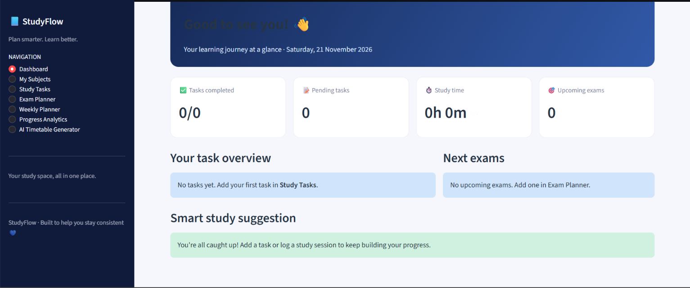
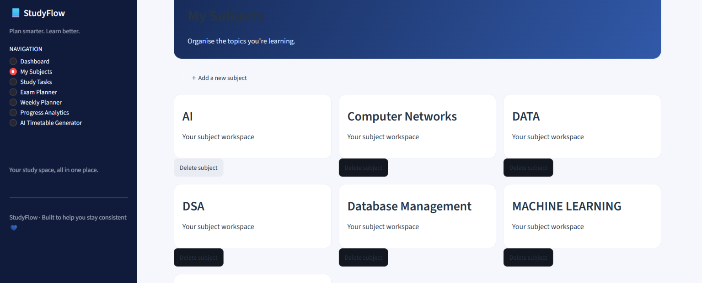
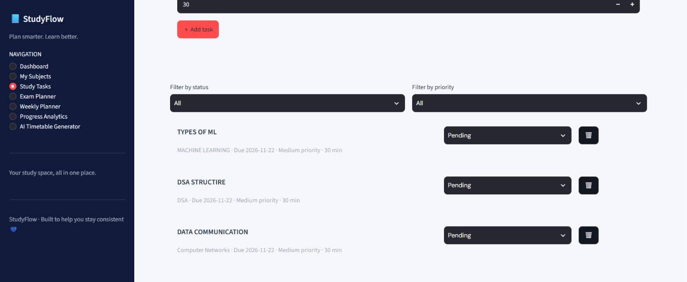
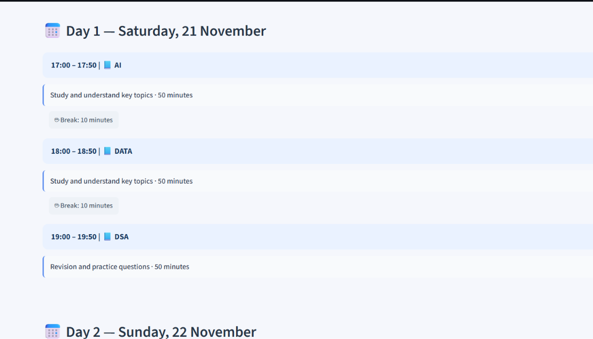

# 📘 StudyFlow – Smart AI Study Planner

A smart and interactive study planning application built with Python and Streamlit. StudyFlow helps students organise their subjects, manage study tasks, plan exams, track progress, and generate personalised study timetables.

## ✨ Features

- 📊 **Dashboard:** Overview of study activities, tasks and upcoming exams.
- 📚 **Subject Management:** Add and manage academic subjects.
- ✅ **Study Task Tracker:** Manage tasks with priorities, deadlines and statuses.
- 📅 **Exam Planner:** Track upcoming examinations with countdowns.
- 🗓️ **Weekly Planner:** Organise weekly study activities.
- 📈 **Progress Analytics:** Visualise study progress through interactive charts.
- 🧠 **Smart Timetable Generator:** Generate personalised study schedules based on subjects, weak areas, available study hours and exam priorities.
- 📥 **CSV Export:** Download generated timetables for offline access.

## 🛠️ Tech Stack

- Python
- Streamlit
- SQLite
- Pandas
- Plotly

## 🚀 Getting Started

### 1. Clone the repository

```bash
git clone https://github.com/prajapatisrushti/StudyFlow-AI-Study-Planner-.git
```

### 2. Navigate to the project folder

```bash
cd StudyFlow-AI-Study-Planner-
```

### 3. Install dependencies

```bash
pip install -r requirements.txt
```

### 4. Run the application

```bash
python -m streamlit run app.py
```

The application will open in your browser.

## 💾 Data Storage

StudyFlow uses a local SQLite database to store study-related information on the user's computer.

## 🎯 Project Objective

To make study planning easier and more organised through a simple, interactive digital platform.

## 👩‍💻 Developer

**Srushti Prajapati**

B.Sc. Computer Science | AI & Full-Stack Development Enthusiast

[GitHub Profile](https://github.com/prajapatisrushti)
---


## 🖥️ Application Screenshots

Explore the key features of StudyFlow through the screenshots below.

### 1. Dashboard
Get an overview of study activities, task completion, study time and upcoming exams.



### 2. Subject Management
Organise and manage academic subjects in one place.



### 3. Study Task Tracker
Manage study tasks with deadlines, priorities and completion statuses.



### 4. Smart Timetable Generator
Choose subjects, study hours, priorities and preferred study time to generate a personalised study schedule.


### 5. Generated Timetable
View your generated study schedule and organise your learning sessions.


